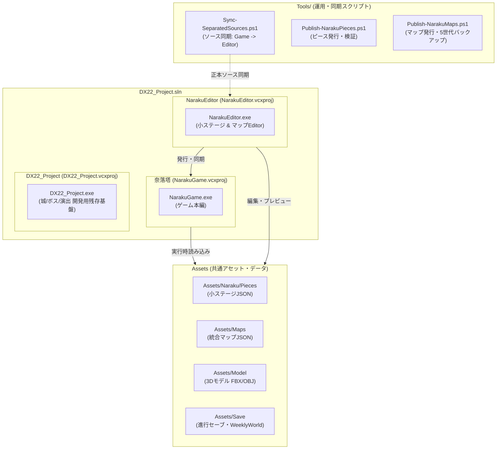
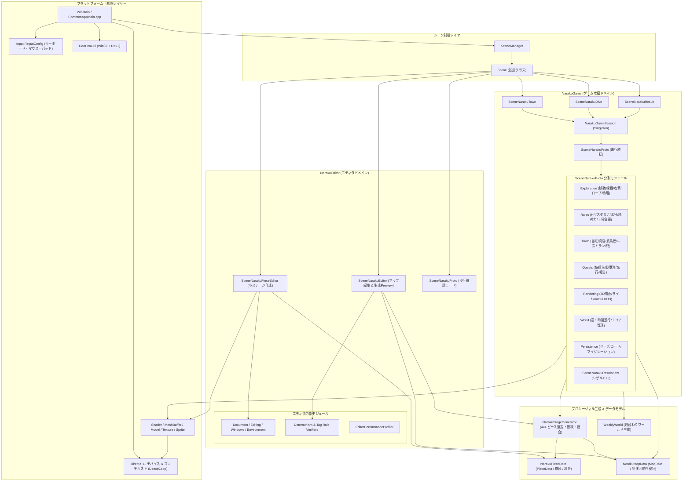
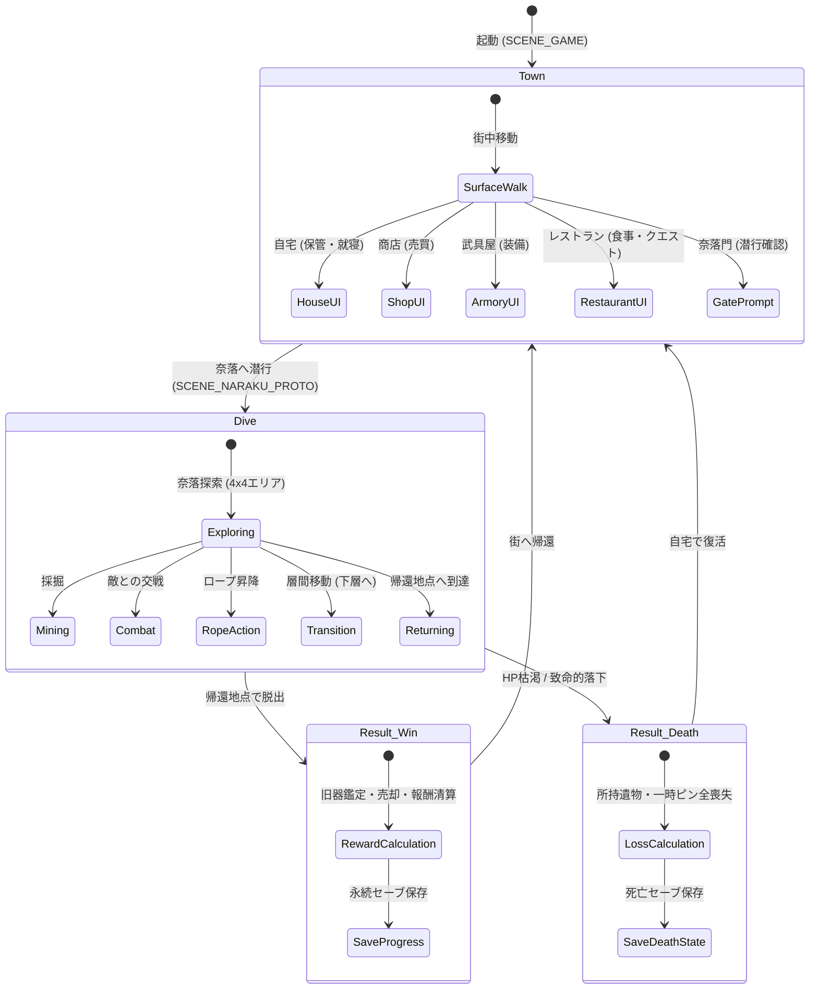
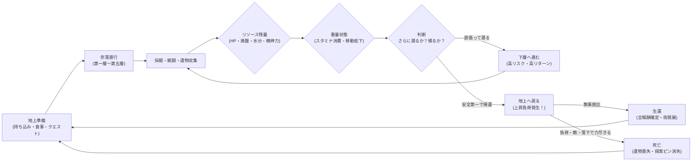
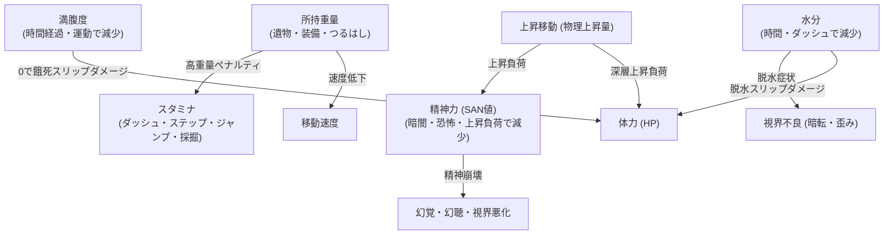
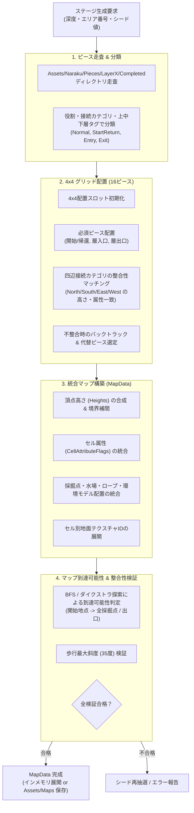
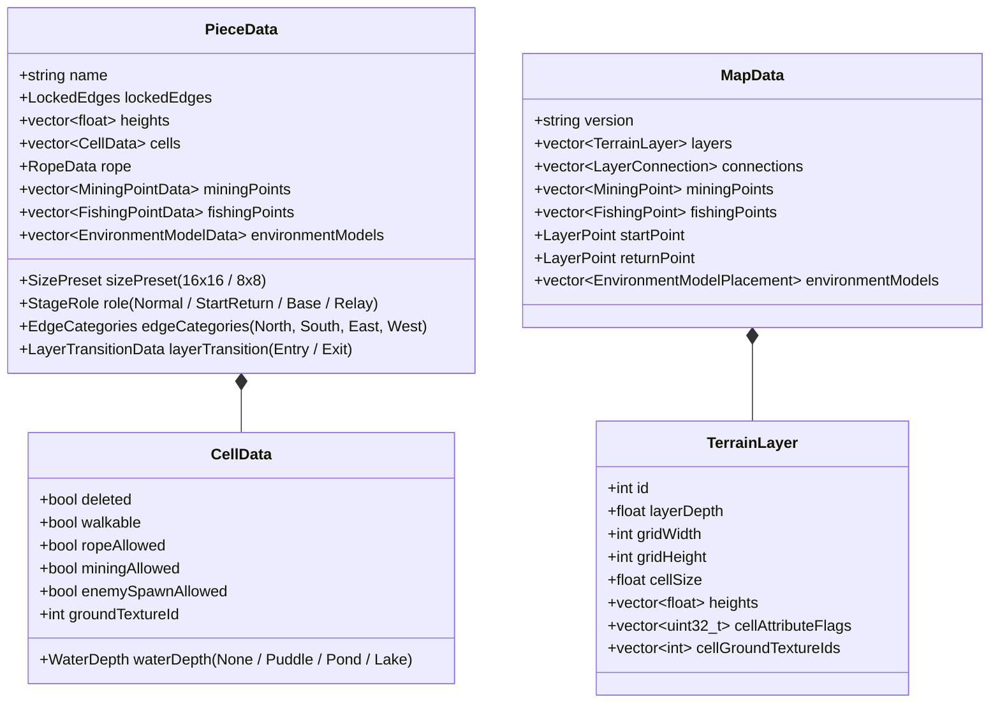
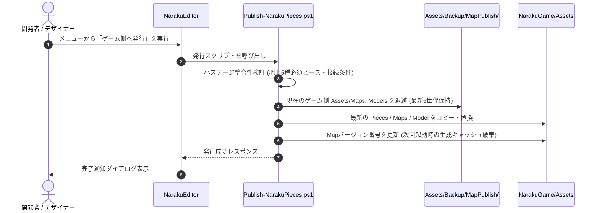
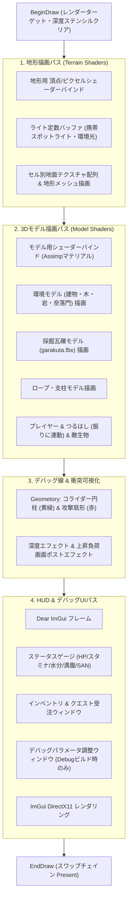

# 奈落塔（NarakuProto） プロジェクト全体設計・構造仕様書

本書は、リポジトリ `NarakuProto` の全体構造、マルチプロジェクト設計、インゲーム・エディタ双方のアーキテクチャ、データパイプライン、プロシージャル生成、およびレンダリング基盤を網羅的に整理・解説した設計ドキュメントです。

---

## 1. プロジェクト概要とリポジトリ構成

### 1.1 プロジェクトの目標と背景
「奈落塔」は、「**帰ってくるまでが遠足**」をコンセプトにした、2.5D探索サバイバルローグライトです。
プレイヤーは地上拠点（街）で準備を整え、奈落（地下階層）へ潜行し、資源採掘・旧器探索・クエスト達成を行いながら生還を目指します。
本作の最大の特徴は、深く潜るほど得られる利益が増大する反面、地上への帰還時に発生する「**上昇負荷（精神力低下・視界不良・割合ダメージ等）**」や「**重量ペナルティ**」「**飢え・水分管理**」によって帰還難度が跳ね上がる点です。

### 1.2 ソリューションとプロジェクト分離構造
本リポジトリは、開発効率化・バイナリ軽量化・責務分離を目的として、1つのソリューション `DX22_Project.sln` のもとに3つの独立したプロジェクトを保持しています。

| プロジェクト名 | 実行ファイル | 主な責務・役割 |
|---|---|---|
| **奈落塔** (`NarakuGame`) | `NarakuGame.exe` | ゲーム本編。地上街（自宅/商店/武具屋/レストラン/奈落門）、奈落探索、リザルト画面、ゲーム内ルール計算、セーブ管理。 |
| **NarakuEditor** (`NarakuEditor`) | `NarakuEditor.exe` | 制作支援。16x16等の小ステージ（ピース）編集、四辺接続整合性の検証、4x4統合ステージ自動生成プレビュー、歩行プレビュー、ゲーム側への発行・バックアップ。 |
| **DX22_Project** (`DX22_Project`) | `DX22_Project.exe` | 派生元のゲーム基盤・残存機能。過去に制作された城エディタ、ボスエディタ、エフェクト検証画面などを単独動作させる環境。 |

---

## 2. 全体アーキテクチャ・データフロー

### 2.1 システム全体のアーキテクチャ図
ゲーム実行系、エディタ系、および共通基盤（DirectX 11、ImGui、Assimp、数学ライブラリ）の連携構造を示します。

---

## 3. シーン管理とプレゼンテーション層設計

### 3.1 仮想シーンとセッション管理 (`NarakuGameSession`)
`NarakuGame` では、`SceneManager` 上のシーン切り替え（`SCENE_GAME`, `SCENE_NARAKU_PROTO`, `SCENE_RESULT`）に対して、内部で実体である `SceneNarakuProto` のインスタンスを破棄せず、`NarakuGameSession` シングルトンで永続保持する設計を採用しています。

これによって、以下のメリットが得られます：
1. **探索状態の安全な維持**: 街から奈落へ潜行、あるいはリザルト画面へ遷移する際、プレイヤーの装備、インベントリ、一時ステータスが安全に保持される。
2. **正規離脱の保証**: 死亡または生還時のデータ保存（永続化）が完了してから次のシーンへ移行し、予期せぬ終了時は「探窟放棄」として安全に回収する。

---

## 4. ゲームプレイ・コアループとサバイバルルール

### 4.1 ゲームプレイループフロー
探索サバイバルの循環構造とリスク/リワードの判断分岐です。

### 4.2 サバイバルパラメータと相互作用
プレイヤーは単なるHPだけでなく、相互に影響を及ぼし合う5つの基本パラメータを管理します。

#### 各パラメータの仕様詳細
1. **体力 (HP)**:
   - 敵の攻撃、高所からの落下、餓死、脱水、深層上昇負荷によって減少。0になると即座に死亡リザルトへ移行。
2. **スタミナ**:
   - 最大100。通常歩行・静止中は即座に高速回復。
   - ダッシュ、ステップ、ジャンプ、つるはし通常攻撃、採掘で消費。
   - 重量率（70% / 90% / 100% / 最大150%）に応じて消費量が増加し、150%超過時は新規アイテム拾得不可。
3. **満腹度**:
   - 時間経過および激しい行動で減少。レストランでの食事や携帯食料で回復。0でHPスリップダメージ。
4. **水分**:
   - 走り続けることで加速減少。地上給水所の水筒、または奈落内の水場から回収して摂取。
   - 奈落の水は煮沸しないと食中毒リスク。枯渇すると脱水症状（視界不良）およびHP減少。
5. **精神力 (SAN値)**:
   - 上昇負荷の主対象。層ごとに設定された上昇量（第一層では累積10m上昇で-10など）により急激に低下。
   - 低下すると視界狭窄、幻覚、幻聴が発生。安全地帯やキャンプ、地上休養で回復。

---

## 5. プロシージャルステージ生成（PCG）アーキテクチャ

奈落塔のマップは、完全ランダムなグリッド生成ではなく、**「手作業で作られた小ステージ（ピース）」を自動アルゴリズムで連結・統合する方式**を採用しています。これにより、手作業による緻密なレベルデザインと、ローグライト特有のランダム性の両立を実現しています。

### 5.1 生成パイプライン
ステージ生成（`NarakuStageGenerator`）の流れを以下に示します。

### 5.2 ピースデータ構造 (`PieceData`) と マップ構造 (`MapData`)

---

## 6. エディタシステム (`NarakuEditor`) と発行パイプライン

### 6.1 小ステージエディタ (`SceneNarakuPieceEditor`)
小ステージエディタは、デザイナーが16x16（地上用8x8等）の独立した地形ピースを作成するための高機能ツールです。

- **3Dビュー操作**: マウスドラッグによる旋回、パン、ズーム、頂点ブラシ選択、高さ昇降。
- **属性ペイント**: 通行不可、崖境界、水場（水溜り/池/湖）、ロープ端点、採掘許可、敵出現許可。
- **環境モデル配置 & AABB当たり判定**:
  - FBX/OBJモデルの配置、Y軸90度刻み回転（0/90/180/270度）。
  - X/Z方向のセル占有矩形設定（モデルの足元専有範囲）。
  - プレイヤー・敵との衝突を防ぐ有限高AABBコライダーの設定、ModelView上での緑色ワイヤーフレーム可視化。
- **検証と保存**: `Drafts`（下書き）と `Completed`（完成）のステータス管理。四辺接続条件の自己検証。

### 6.2 マップエディタ & 生成プレビュー (`SceneNarakuEditor`)
完成した小ステージを組み合わせて構築される統合ステージの動作検証を行います。

- **15段階生成プレビュー**: 第1層〜第5層の各エリア（計15段階）を一括メモリ生成。
- **シード制御**: 64bitシードの手動指定・固定・再生成。
- **俯瞰視点 / 歩行確認視点**:
  - `View` メニューからワンクリックで切り替え。
  - 歩行確認モードでは敵AIを静止させ、ダメージや能力値消費を無効化して安全に地形の歩き心地、ロープ昇降、つるはし通常攻撃の判定範囲を確認可能。

### 6.3 ゲーム側への発行（Publish）とバックアップ機構
エディタで作成・検証した小ステージやマップを、ワンクリックでゲーム本編へ反映するデータ同期パイプラインです。

---

## 7. レンダリング & グラフィックス基盤

本プロジェクトは DirectX 11 を用いた独自グラフィックスパイプラインを構築しています。

### 7.1 レンダリングフロー
1フレームの描画処理は、以下の多層レイヤー構造で実行されます。

### 7.2 携帯スポットライトの光響計算
地下探索の臨場感を高めるため、プレイヤーの前方を照らす携帯スポットライトが実装されています。
- 頂点シェーダーからワールド座標と法線をピクセルシェーダーへ渡し、光源位置・照射方向ベクトル・円錐角（コーンアングル）および距離減衰をピクセル単位で計算。
- 地形メッシュおよびFBXモデルの双方が同一の照明構造体を参照し、均質な陰影を形成。

---

## 8. データ永続化・セーブデータシステム

### 8.1 進行データと週間世界データの二重管理
セーブデータは以下の2系統に分離して保存されます。

| 保存ファイル | フォーマット | 保持データ内容 | リセットタイミング |
|---|---|---|---|
| `Assets/Save/naraku_proto_save.dat` | バイナリ (Version 11) | プレイヤー所持金、レベル、倉庫保管アイテム、装備品、恒久進行度、通常クエスト受注状態 | プレイヤーの意図的なリセット、または死亡時の携行品ロストのみ |
| `Assets/Save/WeeklyWorld/world.dat` | バイナリ | 1週間単位のプロシージャル世界シード、マップ生成キャッシュ、探索済みピン情報 | ゲーム内時間で1週間経過、またはエディタからの新マップ発行時 |

### 8.2 レガシーセーブマイグレーション
初回起動時、旧プロジェクト（`DX22_Project`）のセーブデータパスを探索し、存在すれば `NarakuGame/Assets/Save` へ非破壊コピーを行う自動マイグレーション機構が組み込まれています。

---

## 9. 開発・運用ツール群 (`Tools/`)

リポジトリ直下の `Tools` フォルダには、プロジェクトの健全性を維持するための自動化スクリプト群が整備されています。

1. **`Sync-SeparatedSources.ps1`**:
   - `NarakuGame/Source`（正本）から `NarakuEditor/Source` への共通基盤コードおよび `SceneNarakuProto` 分割ソースの一括同期。
   - `-CheckOnly` オプションにより、CIやビルド前の差分検証が可能。
2. **`Publish-NarakuPieces.ps1`**:
   - 完成済み小ステージを検証し、ゲーム側へ発行。
3. **`Publish-NarakuMaps.ps1`**:
   - 生成済みマップデータをゲーム側へ置換し、最新5世代の自動バックアップを作成。
4. **`Test-SeparatedGenerationParity.ps1`**:
   - 同一シードにおいて、ゲーム側とエディタ側で全く同一のエリア数、接続構成、ピース配置が行われるか（決定論的生成の担保）を自動検証。
5. **`Stage-RuntimeAssets.ps1`**:
   - ビルド出力先（x64 Debug / Release）への必要アセットおよび Assimp DLL の自動配置。

---

## 10. 設計上の強みと将来の展望

### 10.1 現在の設計上の強み
- **完全な責務分離**: ゲーム本編、小ステージEditor、旧残存コードが別プロジェクト・別exeへ分離され、ゲーム実行バイナリに不要な編集コードや重いデータが含まれない。
- **正本同期と自動バックアップ**: ゲーム側を正本とするソース同期スクリプトと、発行時の5世代バックアップ機構により、データ破壊や不整合を防止。
- **決定論的プロシージャル生成**: 64bitシードに基づく生成結果の完全一致テストにより、バグ再現やバランス検証が容易。
- **仮想シーン方式による状態保護**: `NarakuGameSession` により、潜行・帰還・リザルト間の遷移でメモリリークや未保存のデータ欠損を防止。

### 10.2 将来の課題と拡張性
- **第2層以降の固有環境ギミック**: 幻覚・幻聴の実装、暗闇以外の環境効果（胞子、毒霧、水没エリア）。
- **ゲームパッド（XInput/DirectInput）の本格対応**: 現在キーボード・マウス優先の実装をコントローラーナビゲーションへ全面拡張。
- **タイトル画面・リザルト画面の完全独立**: 現在 `SceneNarakuProto` の仮想シーンとして実装されているリザルト・街・タイトルを、段階的に完全独立クラスへ移行可能にする下地を維持。
